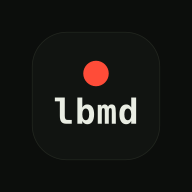
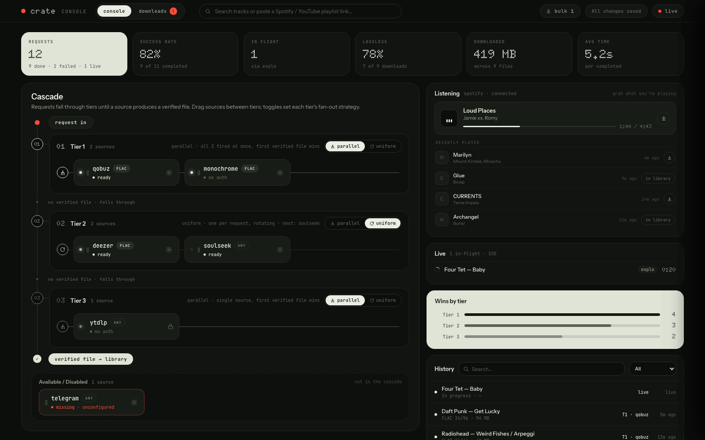
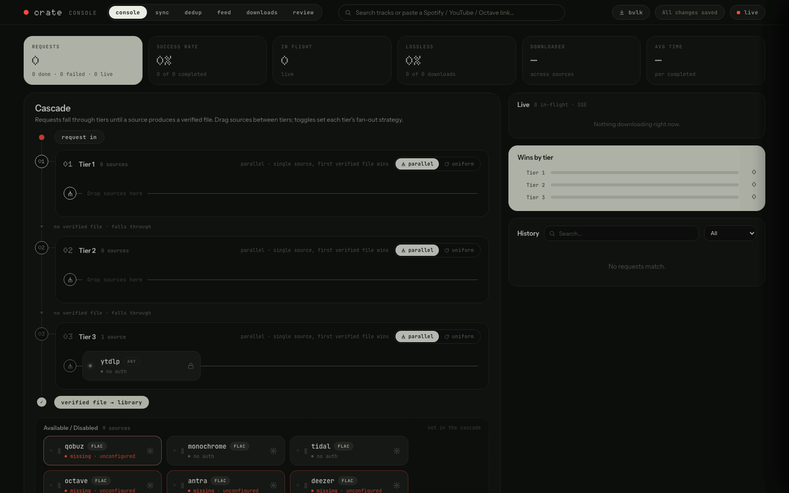
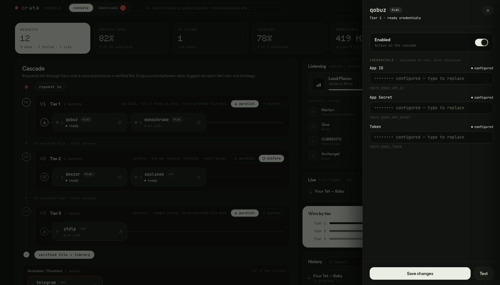
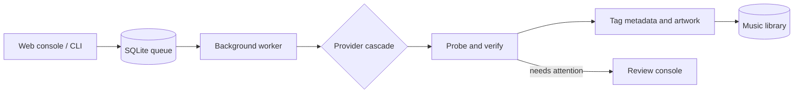

<div align="center">
  
  <h1>crate</h1>
  <p><strong>A self-hosted music acquisition pipeline that searches, verifies, tags, and organizes tracks.</strong></p>

  [](https://github.com/saikhurana98/crate/actions/workflows/ci.yml)
  [](https://github.com/saikhurana98/crate/actions/workflows/release.yml)
  [](LICENSE)
  [](pyproject.toml)
  [](docker-compose.yml)
</div>

Crate queries several providers in parallel, accepts the first verified result
from the best available tier, preserves metadata and artwork, and moves the
finished file into your music library. It includes a responsive web console,
background worker, CLI, review workflow, playlist sync, and an slskd-compatible
API for [Explo](https://github.com/LumePart/Explo).



> Screenshots use sample data and masked credentials.

## Highlights

| | Capability |
| --- | --- |
| **Fast search** | Search every enabled catalog and queue a track from one field. |
| **Tiered cascade** | Prefer lossless providers, rotate or fan out sources, then fall back to yt-dlp. |
| **Verified files** | Probe audio, compare duration and fingerprints, then preserve tags and artwork. |
| **Human review** | Compare candidates and repair failed or lossy downloads from the console. |
| **Private configuration** | Encrypt provider credentials at rest and keep runtime state outside Git. |
| **Portable deployment** | Run the same container on Apple Silicon, Intel Macs, and Linux hosts. |

## Screenshots

<table>
  <tr>
    <td width="50%"></td>
    <td width="50%"></td>
  </tr>
  <tr>
    <td align="center"><strong>Console and cascade</strong></td>
    <td align="center"><strong>Encrypted provider settings</strong></td>
  </tr>
</table>

## Sources

| Tier | Providers | Typical result |
| --- | --- | --- |
| 1 | Qobuz, Monochrome, TIDAL, Octave, Antra | Lossless |
| 2 | Deezer, arcod, Soulseek, Telegram | Lossless or best available |
| 3 | yt-dlp | Lossy fallback |

Providers can be enabled, ordered, configured, and tested from **Provider
Settings**. Some services require your own account or API credentials. Use Crate
only for media you are authorized to download.

## Quick start on macOS

Install [Docker Desktop](https://www.docker.com/products/docker-desktop/), then:

```bash
git clone https://github.com/saikhurana98/crate.git
cd crate
cp .crate.env.example .crate.env
mkdir -p data downloads slskd-downloads
docker compose up -d
```

Open [http://localhost:8788](http://localhost:8788). The console and
slskd-compatible API bind to localhost by default. Finished tracks appear in
`downloads/library/`; work in progress stays in `downloads/staging/`.

```bash
docker compose ps
docker compose logs -f crate-console crate-serve
```

### Configure providers

Open **Provider Settings**, enter only the credentials for sources you use, and
run each provider's test download. Values are encrypted in `data/crate.db` with
`data/config.key`; back up both files together. They are excluded from Git and
are never exported to a plaintext JSON file.

Environment configuration is also supported through `.crate.env`:

```bash
$EDITOR .crate.env
docker compose up -d --force-recreate
```

When enabling Soulseek, point the `slskd-downloads` bind mount in
`docker-compose.yml` at the host directory used by slskd.

### Run the CLI

```bash
docker compose run --rm crate-cli download "Daft Punk Get Lucky" -o /downloads/library
docker compose run --rm crate-cli download --source monochrome "Zara Sa" -o /downloads/library
```

Update or stop the stack with:

```bash
docker compose pull
docker compose up -d
docker compose down
```

## Architecture



The domain and application layers do not depend on provider implementations.
Each source implements the same search and download boundary, so new providers
can be added without changing the scheduler. See [ARCHITECTURE.md](ARCHITECTURE.md)
and [the source integration guide](docs/adding-a-source.md).

## Development

Python 3.11 or newer, `uv`, ffmpeg, fpcalc, yt-dlp, and Node.js 22 are required.

```bash
uv sync --frozen
uv run ruff check .
uv run ruff format --check .
uv run mypy
uv run pytest
cd apps/console && npm ci && npm run build
```

Python coverage must remain at or above 90%. See [AGENTS.md](AGENTS.md) for
repository conventions and [CONTRIBUTING.md](CONTRIBUTING.md) before opening a
pull request.

## Security

Never commit `.crate.env`, `.env`, `creds/`, `data/`, HAR captures, session
files, databases, or downloaded media. CI scans new commits for secrets and
GitHub secret scanning with push protection is enabled. Report vulnerabilities
through GitHub private vulnerability reporting; see [SECURITY.md](SECURITY.md).

Crate is available under the [MIT License](LICENSE).
